<div align="center">


# Utsav AI

### Every celebration, *beautifully planned*

A GenAI planning assistant for weddings, birthdays, pujas and neighbourhood festivals:<br>
a budget that adds up, a timeline worked back from the big day, the vendors to book,<br>
and ideas that feel unmistakably yours.

[](https://utsav-ai-0zi4.onrender.com)
[](#how-gemini-is-used)


**PromptWars Virtual · Challenge 5: Celebration & Event Planner**

<br>

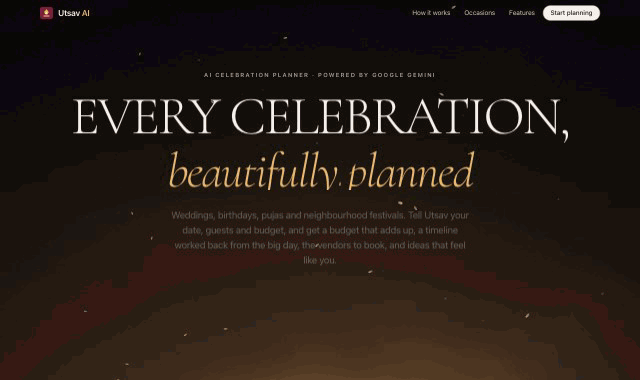

</div>

<br>

## Why Utsav

Planning a celebration means juggling a budget across a dozen categories, booking vendors in the right order, and remembering a hundred small things, usually across scattered WhatsApp chats and spreadsheets. Generic checklists ignore your date, city, guest count, culture and diet. Pure chatbots invent numbers and deadlines.

**Utsav AI splits the work:** a deterministic engine handles everything that must be *correct*, and Google Gemini handles everything that should feel *personal*.

<div align="center">
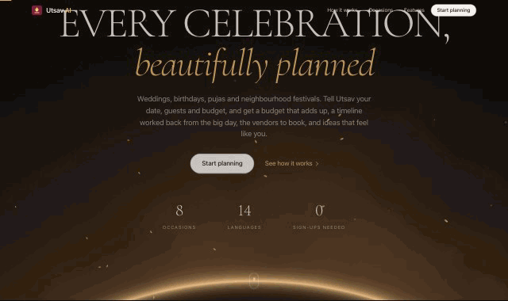
</div>

## See it in action

<table>
<tr>
<td width="50%" valign="top">

**From a wish list to a ready plan.** A pinned scroll story where a sample plan builds itself: budget, themes, checklist.

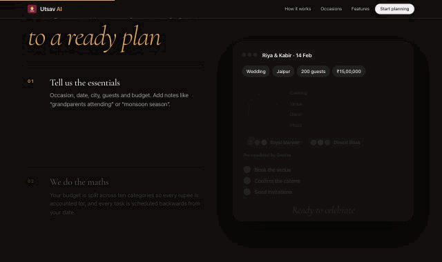
</td>
<td width="50%" valign="top">

**A dashboard, not a chat log.** Countdown, budget health, progress rings, budget donut and what to do next.

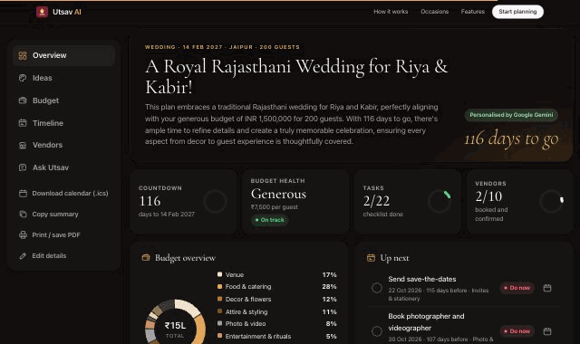
</td>
</tr>
</table>

### The plan dashboard

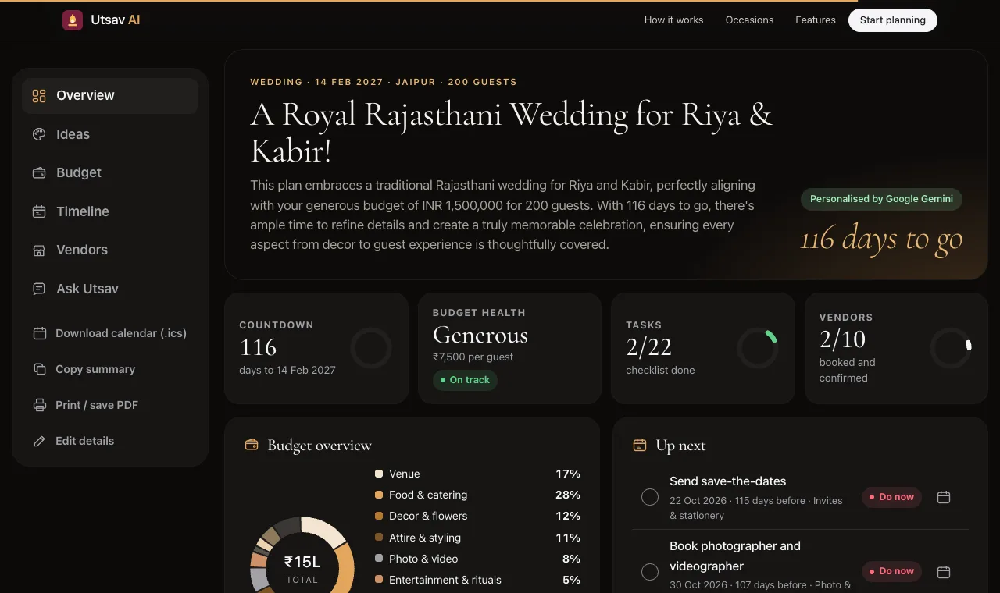

<table>
<tr>
<td width="50%">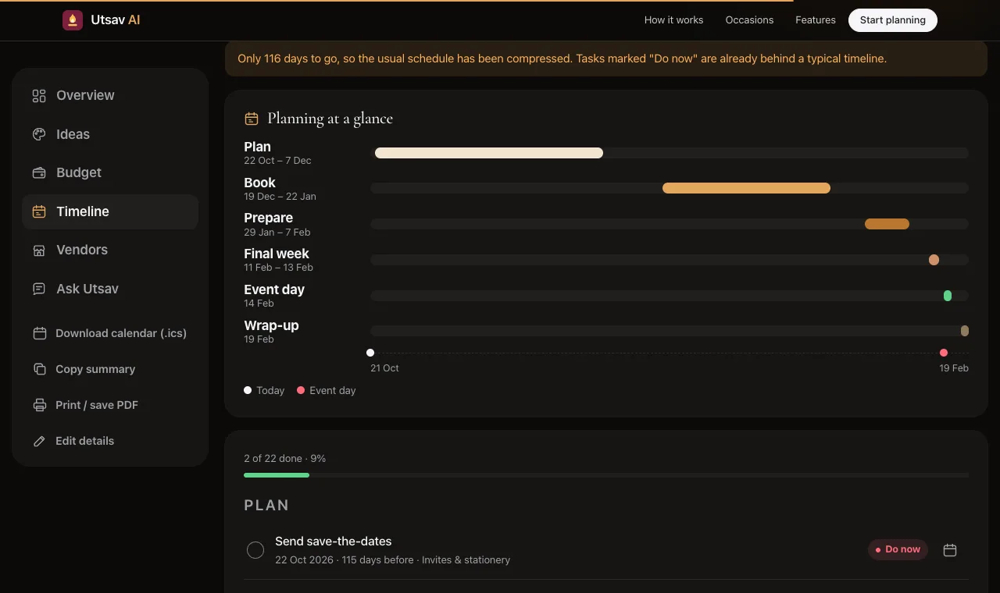<br><sub><b>Timeline.</b> Phases on a month axis, with every task scheduled backwards from the date.</sub></td>
<td width="50%">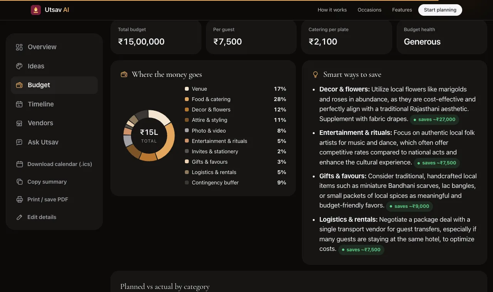<br><sub><b>Budget.</b> A split that always adds up, savings tips with amounts calculated by the server, and planned vs actual spend.</sub></td>
</tr>
<tr>
<td width="50%">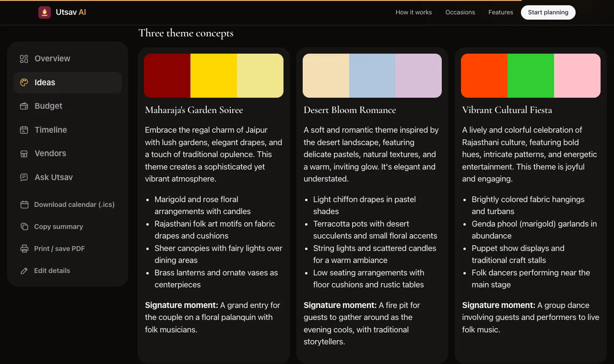<br><sub><b>Ideas.</b> Three themes with palettes, a menu that respects every dietary rule, and a run sheet.</sub></td>
<td width="50%">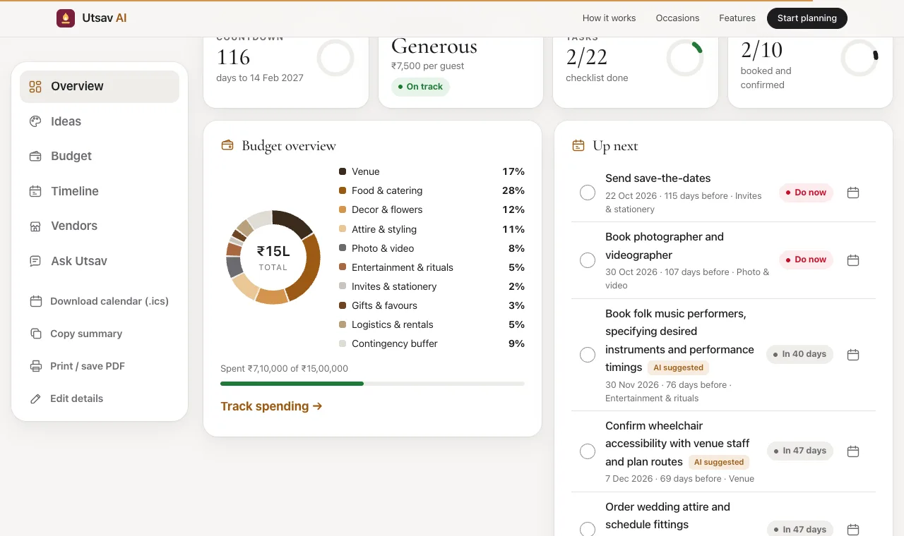<br><sub><b>Light and dark.</b> A restrained warm-neutral system with one saffron-gold accent.</sub></td>
</tr>
</table>

### The landing page

<p align="center">
  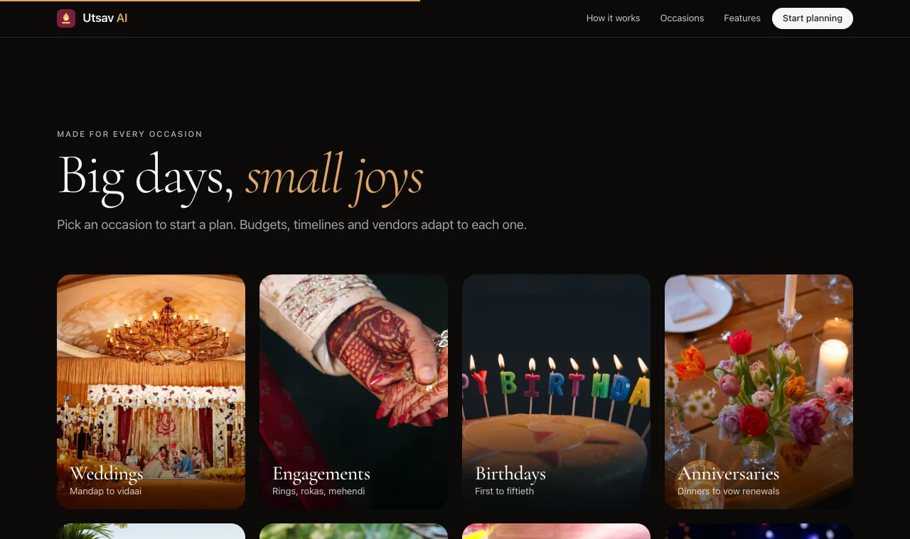
  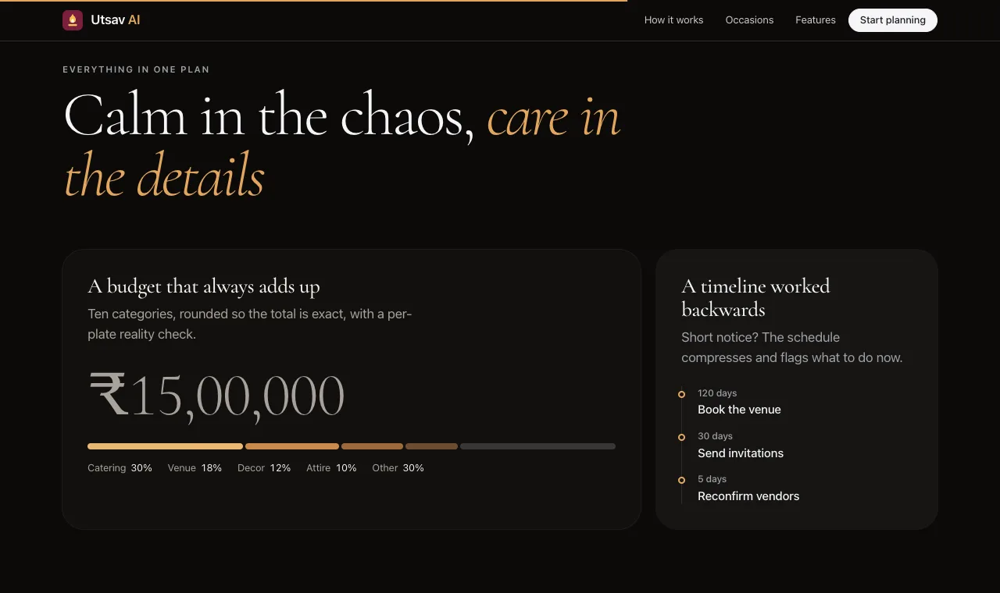
  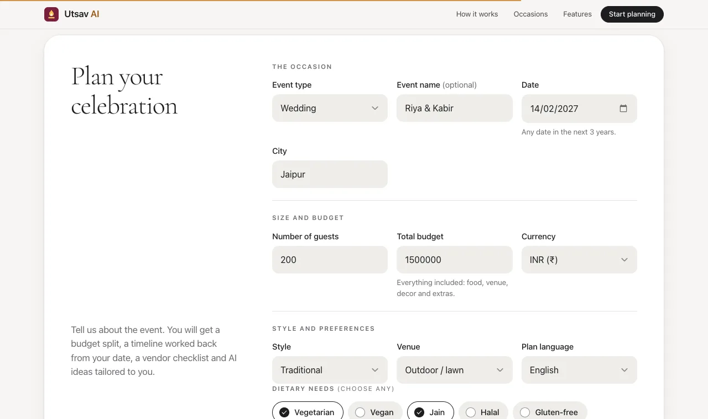
</p>
<p align="center"><sub><b>Occasion gallery</b> that prefills the planner · <b>feature tiles</b> with live counters · <b>the planner</b>: about a minute, no account</sub></p>

<p align="center">
  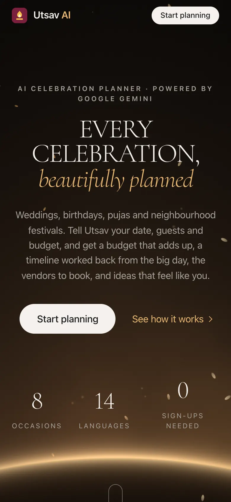
  &nbsp;&nbsp;
  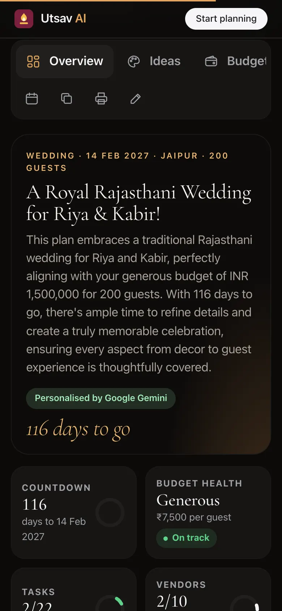
</p>
<p align="center"><sub><b>Built mobile-first.</b> Every view adapts to phones.</sub></p>

## What you get

| Need | How Utsav handles it | Engine or AI |
| --- | --- | --- |
| Budget split | Baseline splits per event type, reshaped by style and venue, rounded by largest remainder so the lines always add up exactly; per-plate feasibility check | Engine |
| Timeline | 15-20 milestones scheduled backwards from the event date; compressed proportionally for short-notice events, with overdue tasks flagged "Do now" | Engine |
| Vendor checklist | Vendors per event type with book-by dates, the questions to ask, and a Google Maps search in your city | Engine |
| Theme concepts | 3 themes with colour palettes, decor ideas and a signature moment, matched to style, budget level and city | Gemini |
| Menu | Regional dishes that respect every dietary rule (e.g. Jain: no onion, garlic or root vegetables) | Gemini |
| Savings | Category-specific tips; Gemini suggests a percentage, the **server computes the amount** from the real budget line | Gemini + engine |
| Personal tasks | Tasks a template would miss (e.g. "book wheelchair-accessible transport for grandparents"), given real due dates by the engine | Gemini + engine |
| Risks and run sheet | Venue, season and crowd risks with mitigations; an event-day schedule | Gemini |
| Ask Utsav | A chat assistant grounded in your computed plan ("How do I cut 15%?"), with follow-up suggestions | Gemini |

Plans can be written in **14 languages**: English, Hindi, Bengali, Tamil, Telugu, Marathi, Gujarati, Kannada, Malayalam, Punjabi, Urdu, Arabic, Spanish and French, with correct `lang` and `dir` attributes for screen readers and right-to-left scripts.

Hosts can tick off tasks and vendors, log actual spend against the plan, export every milestone to their calendar (`.ics` or one-click Google Calendar), copy a summary for the family group, or print to PDF. Progress is saved in the browser.

## How Gemini is used

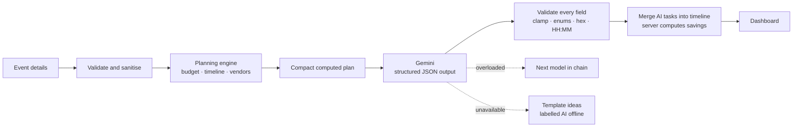

- **Models:** Google Gemini via the Generative Language API (`generateContent`), with a fallback chain `gemini-3.6-flash → gemini-2.5-flash → gemini-3.5-flash` (configurable with `GEMINI_MODEL`). If one model is overloaded, the next is tried automatically.
- **Low latency:** thinking is set low per model family (`thinkingLevel: low` on Gemini 3+, `thinkingBudget: 0` on 2.5). A full plan typically arrives in about 9-11 s, and chat answers in about 4 s.
- **Structured output:** every call uses `responseMimeType: application/json` with a `responseSchema` (enums for budget categories), so responses are machine-checkable.
- **Grounding:** the model receives a compact `<computed_plan>` (budget lines, feasibility, days left, urgent tasks, vendors) and is told these are fixed facts. It reasons about them and never invents its own numbers or dates.
- **Prompt-injection defence:** user notes and questions are wrapped in `<user_notes>` and `<question>` tags and declared untrusted. Output is validated field by field (`src/ai.js`). Strings are length-capped and rendered only with `textContent`.
- **Resilience:** 25 s timeout per attempt within a 45 s overall budget, model fallback on 429/5xx, and identical requests cached for 10 minutes with in-flight de-duplication. If Gemini is unavailable, the app still returns a full plan with template ideas, clearly labelled "AI offline".

## Design

The design was researched from real references (details in [CREDITS.md](CREDITS.md)) and then audited for an Apple-level finish:

- **Design system:** warm neutrals, a single saffron-gold accent and ink pill buttons; a tonal amber ramp for charts instead of a rainbow; system UI text with Cormorant Garamond for display and italic emphasis; filled form fields with custom selects and toggles.
- **WebGL hero:** an original shader of a soft champagne horizon that follows the pointer, with a few slow drifting petals. Two tiny shader programs, no library. It pauses off-screen and in hidden tabs, draws one still frame for reduced-motion users, and falls back to a CSS gradient without WebGL.
- **Motion with purpose:** a masked headline reveal, a statement that lights up word by word as you scroll, a pinned "How it works" story where a plan card assembles itself, photos that settle as they scroll in, panel cross-fades, and rings and charts that draw in.
- **Dashboard:** a sidebar (vertical tabs on desktop, a strip on phones), a live countdown, KPI tiles with progress rings, a budget donut, "Up next" tasks with status pills, a moodboard, the run sheet, and a month-axis Gantt. All charts are hand-built SVG with text alternatives.
- **Still accessible:** decorative layers are `aria-hidden`, content stays visible without JavaScript, motion respects `prefers-reduced-motion`, and `forced-colors` is supported.

## Built for the evaluation criteria

| Criterion | What we did |
| --- | --- |
| **Code quality** | Small single-purpose modules, JSDoc types checked with `tsc --checkJs`, pure functions for the engine, dependency injection for the AI client, fetch, clock and logger |
| **Security** | Strict CSP (`script-src 'self'`, no inline code), HSTS, X-Frame-Options, nosniff, COOP/CORP, Permissions-Policy. 16 KB body cap and content-type check. Allow-list validation. Prototype-safe enum checks. Rate limits (12/min AI, 240/min general). API key server-side only, sent in a header. No stack traces leak. Static files served only from a preloaded allow-list, so path traversal is impossible. Non-root Docker user |
| **Efficiency** | Zero runtime dependencies. Assets loaded once and pre-compressed with Brotli and gzip. ETag/304 support, long-cached fonts and photos. LRU+TTL cache with in-flight de-duplication, so duplicate plans cost one model call. Bounded rate-limiter memory. Compact prompts. WebGL paused off-screen |
| **Testing** | 109 tests with Node's built-in runner: unit tests for every engine, validator, prompt, sanitiser and chart helper; Gemini client tests with a fake fetch; HTTP integration tests (headers, compression, 304, traversal, 400/405/413/415/429, error hiding); tests that keep the HTML in sync with server enums. About 99.9% line coverage |
| **Accessibility** | Skip link, landmarks, every control labelled, fieldsets and legends. Error summary that takes focus, plus `aria-invalid`. WAI-ARIA tabs with arrow, Home and End keys. Live regions for status and chat. Charts with text alternatives. 44 px touch targets. Visible focus rings. Dark mode, `prefers-reduced-motion`, `forced-colors`. `lang` and `dir` on AI text. Print stylesheet |
| **Problem alignment** | Weddings, engagements, birthdays, anniversaries, baby showers, housewarmings, community events and festivals. Budgets, timelines, vendor checklists and personalised ideas, exactly as the brief asks |

## Architecture

```
Browser (vanilla ES modules, no build step)
  │  POST /api/plan, POST /api/chat, GET /api/health
  ▼
Node.js HTTP server (zero runtime dependencies)
  ├─ security.js     CSP, HSTS and other headers; token-bucket rate limiting
  ├─ validation.js   strict allow-list validation and text sanitising
  ├─ planner/        budget.js · timeline.js · vendors.js   (deterministic)
  ├─ service.js      orchestration, caching, AI fallback
  ├─ ai.js           prompts, response schemas, output sanitising
  ├─ gemini.js       Gemini REST client (key in header, timeouts, model fallback)
  └─ static.js       in-memory assets, pre-compressed (brotli/gzip) with ETags
```

## Run locally

Requires Node.js 20.12 or newer. There is nothing to install.

```bash
cp .env.example .env      # add your GEMINI_API_KEY (free at https://aistudio.google.com/apikey)
npm run dev               # http://localhost:8080
npm test                  # run the test suite
npm run test:coverage     # with coverage report
```

## Deploy

**Render (free tier):** `render.yaml` is a ready Blueprint. In the Render dashboard choose *New → Blueprint*, pick this repository and enter `GEMINI_API_KEY` when prompted. Every push to `main` redeploys.

**Google Cloud Run**

```bash
gcloud run deploy utsav-ai --source . --region asia-south1 --allow-unauthenticated \
  --set-env-vars GEMINI_API_KEY=YOUR_KEY
```

For production, store the key in Secret Manager and use `--set-secrets GEMINI_API_KEY=gemini-key:latest`.

**Any container host** (Railway, Fly.io): build the included `Dockerfile` and set `GEMINI_API_KEY`. The container listens on `$PORT` (default 8080), sets `TRUST_PROXY=1` and shuts down cleanly on SIGTERM.

## Project structure

```
server.js            entry point and graceful shutdown
src/                 server modules (see Architecture)
public/              index.html, styles, js/ modules, fonts and photos
test/                node:test suites
docs/media/          README screenshots and GIFs (not served, not in the image)
Dockerfile           production image
render.yaml          Render Blueprint
```

## Credits and license

Photography from [Unsplash](https://unsplash.com) and fonts from Google Fonts. See [CREDITS.md](CREDITS.md). Code released under the MIT License.

<div align="center"><sub>Made with care for PromptWars Virtual · Powered by Google Gemini</sub></div>
